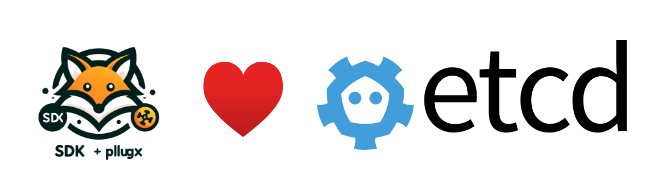

<div align="center">



[](https://github.com/version-fox/vfox-etcd/actions/workflows/lint.yml)
[](https://github.com/version-fox/vfox-etcd/actions/workflows/e2e.yml)
[](https://github.com/version-fox/vfox-etcd/actions/workflows/test.yml)
[](https://github.com/version-fox/vfox-etcd/actions/workflows/license.yml)

</div>

# vfox-etcd 插件

[中文](README_CN.md) | [English](README.md)

这是一个用于 [vfox](https://vfox.dev/) 的 [etcd](https://etcd.io/) 插件。它可以并存安装多个 etcd 版本并在它们之间切换，并在 Linux、macOS 和 Windows 上把 `etcd`、`etcdctl` 和 `etcdutl` 放入 `PATH`。它还可以构建带有 [failpoint](docs/zh-CN/failpoint.md) 的 etcd 以用于混沌测试，并能通过 [`vfox link --detect etcd`](docs/zh-CN/link.md) 接管机器上已经安装的 etcd。

## 安装

安装 [vfox](https://github.com/version-fox/vfox) 后，添加插件、安装版本并选择该版本：

```bash
vfox add etcd
vfox search etcd
vfox install etcd@3.5.12
vfox use -g etcd@3.5.12
etcd --version
```

`vfox add etcd` 会安装最新的发布版本。若要试用 `main`、某个分支，或你正在开发的改动，请参阅 [docs/zh-CN/install-from-source.md](docs/zh-CN/install-from-source.md)。

要让 `etcd` 位于 `PATH` 中，需要将 vfox 接入你的 shell，参见其[快速开始](https://vfox.dev/guides/quick-start.html)。`vfox use -g` 会为之后打开的每个新 shell 选择版本，`vfox use` 则只对当前 shell 生效。

版本及其选择方法，参见 [docs/zh-CN/versions.md](docs/zh-CN/versions.md)。支持的平台参见 [docs/zh-CN/platforms.md](docs/zh-CN/platforms.md)。

## 与 mise 一起使用

[vfox](https://github.com/version-fox/vfox) 是 [mise](https://mise.jdx.dev/) 推荐的插件系统。你可以通过 `vfox:` 前缀直接在 mise 中使用本插件。

```shell
# install etcd & set as global version
mise use -g vfox:version-fox/vfox-etcd@latest

# or install a specific version
mise use -g vfox:version-fox/vfox-etcd@3.5.12

# install for local project (creates .mise.toml)
mise use vfox:version-fox/vfox-etcd@3.5.12
```

这会在 `~/.config/mise/config.toml` 中设置版本：

```toml
[tools]
"vfox:version-fox/vfox-etcd" = "latest"
```

### 使用别名简化

在 `~/.config/mise/config.toml` 中添加一个别名，使用 `etcd` 作为简称：

```toml
[alias]
etcd = "vfox:version-fox/vfox-etcd"
```

之后即可使用简化的语法：

```shell
mise use -g etcd@latest
mise install etcd@3.5.12
```

## 使用已安装的 etcd

如果机器上已经通过包管理器、Homebrew、Scoop 或手动安装的方式装好了 etcd，`vfox link --detect etcd` 会直接接管它，而不会再下载一份。它需要 vfox 1.1.0 或更高版本：

```bash
vfox link --detect etcd
```

链接后的版本以其安装来源命名，例如 `3.5.12-system` 或 `3.5.12-brew`，`vfox use` 可以像选择其他版本一样选择它。关于插件的查找位置、名称的构成方式以及如何手动链接目录，请参阅 [docs/zh-CN/link.md](docs/zh-CN/link.md)。

## 带 failpoint 的 etcd

针对[混沌测试](https://testsigma.com/blog/chaos-testing/)方案，插件可以从源码构建带有 failpoint 的 etcd。它仅适用于 Linux 和 macOS，并且需要 Git、Go 和 GNU Make：

```shell
# install etcd with failpoint
BUILD_WITH_FAILPOINT=yes vfox install etcd@3.5.12

vfox use -g etcd@3.5.12
# start etcd with failpoint
GOFAIL_HTTP="127.0.0.1:22381" etcd

# get all failpoint
curl http://127.0.0.1:22381
```

构建的具体行为及其所需条件，参见 [docs/zh-CN/failpoint.md](docs/zh-CN/failpoint.md)。

## 文档

- [版本](docs/zh-CN/versions.md)：搜索、安装、选择和移除版本
- [平台](docs/zh-CN/platforms.md)：哪些操作系统和 CPU 提供构建版本
- [failpoint](docs/zh-CN/failpoint.md)：使用 `BUILD_WITH_FAILPOINT=yes` 构建 etcd
- [已安装的 etcd](docs/zh-CN/link.md)：使用 `vfox link --detect etcd` 接管机器上的 etcd
- [故障排查](docs/zh-CN/troubleshooting.md)：插件输出的消息以及对应的处理方法
- [变更日志](docs/zh-CN/changes.md)：每个发布版本的变更内容
- [开发](docs/zh-CN/development.md)：插件如何构建、检查和发布
- [E2E 测试](docs/zh-CN/e2e.md)：在 Linux、macOS 和 Windows 上安装插件的测试套件

## 文档网站

[中文](https://version-fox.github.io/vfox-etcd/) · [English](https://version-fox.github.io/vfox-etcd/en/)

双语网站维护在 `website/` 目录下。本地构建和部署说明请参阅 [website/README.md](website/README.md)。

## 发布本插件

维护者可以在默认分支上通过 **Actions → Plugin → Run workflow** 发布插件，输入一个不带 `v` 前缀的稳定插件版本号即可。共享工作流会更新 `metadata.lua`、创建版本提交和标签，并在本仓库中发布 ZIP 和清单文件。无需本地标签或额外的发布令牌。拉取请求只运行检查，PR 标题不再触发发布。

当 `PLUGIN.version` 已与标签一致时，仍支持推送已有的版本标签。如果发布失败，重新运行最初失败的任务即可继续。

该工作流沿用共享的 `@v1` 发布工具版本。更新该工具并不会发布本插件。关于打包约定和首次推出的要求，请参阅[共享工作流文档](https://github.com/version-fox/plugin-manifest-action)。

## 参与贡献

提交拉取请求之前，请先阅读 [docs/zh-CN/development.md](docs/zh-CN/development.md)。其中列出了 CI 运行的检查项，以及在 `docs/changes.md`、`README.md` 和 `README_CN.md` 中需要更新哪些内容。

## 许可证

Apache License 2.0，参见 [LICENSE](LICENSE)。
